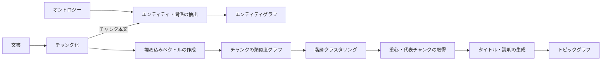

# foundry-iq-graph-lab

## サマリー

Foundry IQ の **Entity Graph、Topic Graph、オントロジー**を検証する 3 冊の機能テストと、構築済みのグラフを **Agentic Retrieval** から使う 2 冊の Notebook を合わせた、計 5 冊の Jupyter Notebook の配布セットです。Entity Graph と Topic Graph は、それぞれの機能テストだけで生成から登録・読み戻し・可視化・GQL 探索まで進められます。Agentic Retrieval の詳細は [Agentic retrieval in Foundry IQ](https://learn.microsoft.com/azure/search/agentic-retrieval-overview) を参照してください。

- **機能テスト 1 は独立**して実行できます。
- **機能テスト 2 の出力を、機能テスト 3 のパート B が使います。** パート A は Azure 接続なしで実行できます。
- **機能テスト 1 の 15・16 章は登録済みの Entity Graph を可視化・探索**します。既存の取り込み結果を再利用し、可視化のための再取り込みは行いません。
- **機能テスト 2 の 9 章は Topic Graph を Foundry IQ に登録し、読み戻して可視化・探索**します。既定では無効です。`RUN_FOUNDRY_IQ` を有効にし、初回書き込みは登録計画を確認してから `CONFIRM_TOPIC_WRITES` で承認します。
- **Agentic Retrieval の 2 冊（以下、AR-E・AR-T）は、機能テスト 1・2 が作成した既存のグラフを読み取って使います。** AR-E（[agentic-retrieval-entity-graph.ipynb](./agentic-retrieval-entity-graph.ipynb)）は、1 で同期した Entity Graph を手書きの GQL と自然言語の `retrieve` の 2 通りで検索します。AR-T（[agentic-retrieval-topic-graph.ipynb](./agentic-retrieval-topic-graph.ipynb)）は、2 の 9 章で登録したトピック インデックスを使い、同じ質問を `none`・`balanced`・`diverse` の 3 方式で比較します。どちらもグラフの構築や再抽出は行いません。
- **[data/heritage-sites](./data/heritage-sites) に、架空の世界遺産を題材にした Markdown 記事 10 件を同梱しています。** いずれのノートブックも、このフォルダーを読み込みません。
- 入力テキストは同梱しますが、Foundry IQ Skills のランタイムは同梱しません。**機能テスト 3 と、1 の外部 JSON-LD 検証・変換を使う場合だけ、利用者が公式配布元からダウンロードして配置します。** Copilot やプラグインのインストールは不要です。
- Azure リソース、Python 本体、外部依存パッケージ、Topic Graph のネイティブ実行ファイルは同梱していません。初回の準備にはインターネット接続が必要です。
- ノートブックの保存済み出力と実行カウントはクリアしています。実環境の接続先や認証情報を記載した設定ファイルは含みません。

Entity Graph はエンティティ間の関係、Topic Graph は文書群のトピック階層を扱います。両機能のプレビュー条件と前提は、Microsoft Learn の [Entity Graph](https://learn.microsoft.com/azure/search/agentic-knowledge-source-how-to-entity-graph) と [Topic Graph](https://learn.microsoft.com/azure/search/agentic-knowledge-source-how-to-topic-graph) を参照してください。

## 1. 全体像と実行順


| ノートブック | 主な入力と処理 | 確認すること | 依存関係 |
|---|---|---|---|
| [機能テスト 1: Entity Graph](./functional-test-1-entity-graph.ipynb) | 2 記事を Blob に配置し、取り込み・ベクトル化・関係抽出を実行。登録済みオントロジー・実体・関係を読み戻して描画 | オントロジーの後付け、キャッシュ再利用、再現率、複数文書をまたぐ関係、GQL 探索・集計・根拠本文 | 他のノートブックには依存しません。内蔵オントロジーを使用し、外部 JSON-LD は任意です |
| [機能テスト 2: Topic Graph](./functional-test-2-topic-graph.ipynb) | 2 記事をチャンク化・ベクトル化し、ローカルで階層を構築。任意で専用インデックスへ登録し、読み戻して描画 | 全ステージ、所属、出力の整合性、設定変更の復元、再開、登録件数、GQL の階層探索・集計 | 他のノートブックには依存しません。ローカル出力を 3-B に渡します |
| [機能テスト 3: オントロジー](./functional-test-3-ontology.ipynb) | A: 固定の Turtle を取り込み・検証。B: Topic Graph と元の Foundry IQ インデックスからモデルがオントロジーを提案 | 取り込み、レビュー、承認、JSON-LD 出力、規則違反の検出、版の差分、提案の根拠と費用上限 | A は独立。B は機能テスト 2 の完了が必要です |
| [Agentic Retrieval: Entity Graph（AR-E）](./agentic-retrieval-entity-graph.ipynb) | 機能テスト 1 の登録済み Entity Graph を、型と述語を指定した手書きの GQL（3 章）と、自然言語の `retrieve`（4 章）で検索。生成された GQL、`activity`、グラフ行、根拠チャンクを読み戻す | 直接 GQL とナレッジ ベース経由の検索の差、`activity` の生成 GQL と処理時間、参照のグラフ行と根拠本文 | 機能テスト 1 で同期済みのグラフ対応ソース（既定名 `ft-entity-ks`）が必要です。4 章はチャット モデルの呼び出しと、専用ナレッジ ベースの新規作成を伴います |
| [Agentic Retrieval: Topic Graph（AR-T）](./agentic-retrieval-topic-graph.ipynb) | 機能テスト 2 の `ft-topic-src` に Topic Graph を接続し、同じ質問を `none`・`balanced`・`diverse` の 3 方式で `retrieve` | 返ったチャンク、出典の参照、`activity` を 3 方式で並べた比較 | 機能テスト 2 の 9 章で登録したトピック インデックスが必要です。チャット モデルは使いません |

推奨順は **1 → 2 → 3-A → 3-B** です。1 と 2 は独立して実行できます。AR-E は 1 の後、AR-T は 2 の 9 章の後に実行します。Azure を使わずに構造検証だけを試す場合は、3-A から始められます。ただし、初回のパッケージ取得は必要です。

機能テスト 1 は既定で内蔵オントロジーを使います。3 の出力を使う場合だけ `ONTOLOGY_PATH` に JSON-LD を明示し、作成経路で検証・変換・登録します。3 の出力で既存グラフが自動更新されることはありません。外部スキーマに内蔵テストの型・関係がなければ、T10〜T12 は未実施として表示します。Topic Graph の検索プロファイル設定とナレッジ ベースへの接続は対象外です。1 のナレッジ ベース検証 T13 は引き続き任意です。

## 2. 配布内容

| ファイル・フォルダー | 用途 |
|---|---|
| [functional-test-1-entity-graph.ipynb](./functional-test-1-entity-graph.ipynb) | Entity Graph の機能テスト |
| [functional-test-2-topic-graph.ipynb](./functional-test-2-topic-graph.ipynb) | Topic Graph の機能テスト |
| [functional-test-3-ontology.ipynb](./functional-test-3-ontology.ipynb) | オントロジーの機能テスト |
| [agentic-retrieval-entity-graph.ipynb](./agentic-retrieval-entity-graph.ipynb) | 登録済み Entity Graph の Agentic Retrieval（AR-E） |
| [agentic-retrieval-topic-graph.ipynb](./agentic-retrieval-topic-graph.ipynb) | 登録済み Topic Graph の Agentic Retrieval（AR-T） |
| [近藤寺 - Hanapedia.txt](<./近藤寺 - Hanapedia.txt>)、[花ケ咲神社 - Hanapedia.txt](<./花ケ咲神社 - Hanapedia.txt>) | 機能テスト 1・2 の入力記事 |
| [data/heritage-sites/](./data/heritage-sites) | 架空の世界遺産を題材にした Markdown 記事 10 件。一覧は下の表のとおりです |
| [.env.example](./.env.example) | 接続先、デプロイ名、モデル単価の設定例 |
| [.gitignore](./.gitignore) | 実行時の設定、作業データ、仮想環境などを除外する設定 |

入力記事とノートブックを同じフォルダーに配置してください。外部ランタイムの取得・配置方法は、下の「5.2 ランタイムの手動取得・配置」に記載しています。

## 3. 実行環境と固定バージョン

本配布手順は **Windows x64、Python 3.12、VS Code の Jupyter 環境**を想定しています。下記の公式ランタイムには Python 3.12 / 3.13 / 3.14 の依存関係ロックがありますが、すべての組み合わせをこのセットで実行検証したわけではありません。

| 項目 | このセットで使うもの |
|---|---|
| Python | 3.12 を推奨。ノートブックごとに実行カーネルを選択します |
| Foundry IQ 用 SDK | `azure-search-documents==12.2.0b1` |
| グラフ関連の Foundry IQ API | `2026-11-01-preview` |
| Topic Graph 実行ファイル | `topicgraph` 1.0.10。ノートブックが固定ダイジェストを照合して取得します |
| オントロジー用ランタイム | 手動取得する公式 `foundry-iq-skills` の `ontology-skills` 0.1.0。取得先のコミットは 5.2 に記載しています。起動時に wheel とロックのダイジェストを検証します |
| 認証 | Microsoft Entra ID。ライブ実行では Azure CLI のサインインなど、`DefaultAzureCredential` が利用できる資格情報が必要です |

ノートブック側の依存パッケージは、機能テスト 1〜3 の最初の `%pip install` セルでインストールします。AR-E・AR-T には `%pip install` セルがありません。import エラーが出る場合、または SDK が `12.2.0b1` でない場合は、各ノートブックの「カーネルの依存パッケージ」に記載のコマンドを、選択したカーネルで実行してください。オントロジー用 CLI は、取得したランタイムの起動処理がノートブックのカーネルとは別の専用環境をユーザー別キャッシュに準備します。ダウンロードした wheel やロックを手作業で差し替えないでください。

出典: [SDK 12.2.0b1](https://pypi.org/project/azure-search-documents/12.2.0b1/) / [ネイティブ実行ファイル v1.0.10](https://github.com/Azure/foundry-iq-tool-releases/releases/tag/v1.0.10) / [Foundry IQ Skills の前提条件とランタイム準備](https://github.com/microsoft/azure-skills/blob/main/.github/plugins/foundry-iq-skills/README.md)

## 4. Azure 側の前提条件

**このセットは、既存の Azure リソースを使います。** Foundry IQ サービス、Azure OpenAI リソース、ストレージ アカウントの新規作成や、ロール付与は行いません。SDK 名、API 識別子、環境変数、組み込みロール名は実際の名称のままです。

| リソース | 必要な用途 |
|---|---|
| グラフ機能のプレビューに対応した Foundry IQ | 1 のナレッジ ソースとグラフ、2 のソース インデックスと公開用トピック インデックス。AR-E は 1 のナレッジ ソース、AR-T は 2 のソース インデックスと公開用トピック インデックスを読み取ります |
| Azure OpenAI のチャット デプロイ | Entity Graph の関係抽出、Topic Graph のラベル付け、オントロジー提案、AR-E の 4 章（検索モデル） |
| Azure OpenAI の埋め込みデプロイ | 記事チャンクのベクトル化 |
| ソース用の標準 Blob Storage | 機能テスト 1 の記事配置。階層型名前空間は無効にします。公式の Entity Graph 手順では ADLS Gen2 は対象外です |
| キャッシュ用の汎用 v2 ストレージ アカウント(`StorageV2`) | 機能テスト 1 のエンリッチメント キャッシュの Blob コンテナーとテーブル |

機能テスト 1 の入力ソースでは、最初の取り込み前にネイティブな Blob の論理削除を有効化し、Blob のバージョン管理を無効化します。T3 は入力ソースの 3 条件とキャッシュ保存先の種類を検証し、不適合なら削除・アップロード・ナレッジ ソース作成を止めます。ストレージの設定やリソース ID を変更した場合は T3 を再実行してください。設定の変更は自動で行いません。

キャッシュ保存先の階層型名前空間を無効化するという条件は、引用した公式資料では確認できないため、入力ソースの条件をキャッシュに適用しません。Foundry IQ からストレージへの到達性は別途確認が必要です。ARM の設定を取得できたことだけでは到達性を検証したことになりません。

権限の目安は次のとおりです。既存の付与で足りていれば、追加付与は不要です。

| 利用する ID | 必要なアクセス |
|---|---|
| 実行ユーザー | Foundry IQ の構成変更とデータ操作。組み込みロールでは Search Service Contributor と Search Index Data Contributor |
| 実行ユーザー | Azure OpenAI の直接呼び出し。組み込みロールでは Cognitive Services OpenAI User |
| 実行ユーザー（機能テスト 1 の新規作成） | ソース用ストレージへの Blob 書き込みと両ストレージの ARM 設定の読み取り |
| Foundry IQ のマネージド ID | ソース用の Storage Blob Data Reader、キャッシュ用の Storage Blob Data Contributor と Storage Table Data Contributor |
| Foundry IQ のマネージド ID | Azure OpenAI に対する Cognitive Services OpenAI User |

ストレージやモデルのファイアウォール設定など、ID 以外の接続条件も必要です。403 などが出た場合に、権限不足と決めつけてロールを追加しないでください。

出典: [Entity Graph の前提条件](https://learn.microsoft.com/azure/search/agentic-knowledge-source-how-to-entity-graph#prerequisites) / [Blob ナレッジ ソース](https://learn.microsoft.com/azure/search/agentic-knowledge-source-how-to-blob) / [エンリッチメント キャッシュ](https://learn.microsoft.com/azure/search/enrichment-cache-how-to-configure) / [Foundry IQ のロールベース認証](https://learn.microsoft.com/azure/search/search-security-rbac)

## 5. クイックスタート

### 5.1 フォルダーと実行カーネル

1. 配布フォルダー `foundry-iq-graph-lab` を、書き込み可能なローカル ディスクに配置します。
2. VS Code で **このフォルダー自体**を開きます。ノートブックの作業ディレクトリも、このフォルダーにします。
3. Python 3.12 のカーネルを選択します。保存されているカーネル表示名は共通の `Python 3` にしてあります。

各ノートブックの `Path(".")` は、作業ディレクトリを基準にします。記事が見つからない場合は、最初にこの位置を確認してください。同期対象やネットワーク上の場所は、Topic Graph のチェックポイント保存時のロックを避けるためにも推奨しません。

機能テスト 1 の内蔵オントロジー、登録済みグラフの可視化、機能テスト 2 の実行には、以下のランタイムは不要です。

### 5.2 ランタイムの手動取得・配置

**必要なのは機能テスト 3 と、機能テスト 1 で外部 JSON-LD を指定する場合だけです。** ノートブックはランタイムを自動取得しません。未配置の場合は取得・配置を案内して停止します。

1. [Microsoft の公式ソース ZIP をダウンロード](https://github.com/microsoft/azure-skills/archive/7847020998043c6231929b364c35393b7cdab270.zip)します。この手順で確認したコミットは `7847020998043c6231929b364c35393b7cdab270` です。[公式配布元](https://github.com/microsoft/azure-skills/tree/7847020998043c6231929b364c35393b7cdab270/.github/plugins/foundry-iq-skills)を参照できます。
2. ZIP を解凍し、`azure-skills-7847020998043c6231929b364c35393b7cdab270\.github\plugins\foundry-iq-skills` フォルダーを取り出します。`bootstrap.py` だけでは動かないため、フォルダー内のマニフェスト・wheel・ロックを含めて取得してください。
3. 取り出した `foundry-iq-skills` フォルダーを、機能テスト 3 冊のノートブックと同じ階層に配置します。AR-E・AR-T はこのランタイムを使いません。

```text
foundry-iq-graph-lab\
  functional-test-1-entity-graph.ipynb
  functional-test-2-topic-graph.ipynb
  functional-test-3-ontology.ipynb
  foundry-iq-skills\             ← 利用者がダウンロードして配置
    graph\runtime\
      bootstrap.py
      manifest.json
      wheels\
      locks\
```

別の場所へ展開する場合は、`.env` の `FOUNDRY_IQ_PLUGIN_ROOT` に **`graph` フォルダーを含むルート**を指定します。`graph\runtime` 自体のパスではありません。

```dotenv
FOUNDRY_IQ_PLUGIN_ROOT=D:\tools\foundry-iq-skills
```

配置後に、次の確認が `True` を返すことを確認します。別の配置先を使う場合はそのパスへ置き換えます。

```powershell
Test-Path -LiteralPath '.\foundry-iq-skills\graph\runtime\bootstrap.py'
Test-Path -LiteralPath '.\foundry-iq-skills\graph\runtime\manifest.json'
```

機能テスト 3 は 1.3 のセルで `setup ontology` を実行します。機能テスト 1 の外部 JSON-LD 機能だけを使う場合は、選択済みの既存 Python 環境で次を一度実行してから進めます。初回は依存パッケージの取得が必要です。この準備は Azure やモデルを呼び出しません。

```powershell
python -I '.\foundry-iq-skills\graph\runtime\bootstrap.py' setup ontology
```

取得したフォルダーは [.gitignore](./.gitignore) で除外しており、このリポジトリに再同梱しません。別のコミットへ更新する場合は、このノートブックとの互換性を確認してください。

出典: [GitHub のソース ZIP ダウンロード](https://docs.github.com/en/repositories/working-with-files/using-files/downloading-source-code-archives) / [公式ランタイムの準備手順](https://github.com/microsoft/azure-skills/blob/7847020998043c6231929b364c35393b7cdab270/.github/plugins/foundry-iq-skills/README.md#prepare-the-graph-runtime)

### 5.3 設定とサインイン

PowerShell で配布フォルダーへ移動し、設定例をコピーします。

```powershell
Set-Location 'D:\path\to\foundry-iq-graph-lab'
Copy-Item -LiteralPath '.env.example' -Destination '.env'
```

`.env` を編集し、`<...>` を実際の値に置き換えます。ライブ実行で Azure CLI の資格情報を使う場合は、対象のテナントへサインインします。

```powershell
az login --tenant '<tenant-id-or-domain>'
```

| 設定名 | 必要な範囲 | 内容 |
|---|---|---|
| `AZURE_SEARCH_ENDPOINT` | 1・2 の作成／公開／読み戻し、AR-E・AR-T | Foundry IQ の HTTPS エンドポイント |
| `AZURE_OPENAI_ENDPOINT` | 1・2 の作成、3-B、AR-E の 4 章。AR-T は検索フィールドにベクトライザーを追加する場合のみ | Azure OpenAI の HTTPS エンドポイント |
| `AZURE_OPENAI_DEPLOYMENT` | 1・2 の作成、3-B、AR-E の 4 章 | チャットのデプロイ名。AR-T では不要です |
| `AZURE_OPENAI_EMBEDDING_DEPLOYMENT` | 1・2 の作成。AR-T は検索フィールドにベクトライザーを追加する場合のみ | 埋め込みのデプロイ名 |
| `AZURE_STORAGE_RESOURCE_ID` | 1 の作成 | ソース用ストレージの ARM リソース ID |
| `AZURE_CACHE_STORAGE_RESOURCE_ID` | 1 の作成 | キャッシュ用ストレージの ARM リソース ID |
| `AZURE_OPENAI_MODEL` | 1・2 の作成、必要時。AR-E の 4 章は必須 | チャットの実モデル名。デプロイ名と異なる場合に指定します。AR-E の 4 章では、デプロイ名と同じ場合も指定します |
| `AZURE_OPENAI_EMBEDDING_MODEL` | 1 の作成、AR-T、必要時 | 埋め込みの実モデル名。未指定時はデプロイ名を使用 |
| `MODEL_INPUT_PRICE_PER_1M` | 3-B | 入力 100 万トークンあたりの実際の料金（米ドル） |
| `MODEL_OUTPUT_PRICE_PER_1M` | 3-B | 出力 100 万トークンあたりの実際の料金（米ドル） |
| `FOUNDRY_IQ_PLUGIN_ROOT` | 3・1 の外部 JSON-LD、配置先を変える場合 | 手動取得した `foundry-iq-skills` のルート。未指定ならノートブックと同じ階層の `foundry-iq-skills` を使用 |
| `TOPICGRAPH_EXE` | 任意 | 検証対象の `topicgraph` 実行ファイル。未指定ならキャッシュ探索または固定版を取得 |
| `FOUNDRY_IQ_ENTITY_SOURCE` | AR-E、任意 | 検索対象の Entity Graph ナレッジ ソース名。未指定なら `ft-entity-ks` |
| `FOUNDRY_IQ_ENTITY_KB` | AR-E、任意 | 4 章で作成・再利用する専用ナレッジ ベース名。未指定なら `ft-entity-agentic-kb` |
| `FOUNDRY_IQ_TOPIC_INDEX` | AR-T、任意 | 登録済みのトピック インデックス名。未指定なら `.functional-test/published-resources.json` の記録を使い、記録がなければ `ft-published-topics-` で始まるインデックスを探します。候補が 0 件または複数のときは停止します |

`FOUNDRY_IQ_ENTITY_SOURCE`、`FOUNDRY_IQ_ENTITY_KB`、`FOUNDRY_IQ_TOPIC_INDEX` は [.env.example](./.env.example) に記載していません。変更する場合だけ `.env` に追加してください。AR-E・AR-T は、`.env` の値を同名の環境変数より優先します。

3-B の単価は、利用するデプロイの料金を確認して設定してください。配布物には過去のビルド記録を含めていないため、その記録から単価を補うことはできません。単価を仮に 0 として予算判定を通さないでください。

出典: [Azure CLI のサインイン](https://learn.microsoft.com/cli/azure/authenticate-azure-cli-interactively) / [Azure OpenAI の料金](https://azure.microsoft.com/pricing/details/cognitive-services/openai-service/)

### 5.4 ノートブックの実行

1. 各冊のパッケージ インストールと設定セルを実行します。
2. 対象の接続先、リソース名、費用が発生する処理を確認します。実行ファイルやランタイムの検証が FAIL の場合は、後続を実行しません。
3. 機能テスト 1 は、`RUN_BUILD = True` で生成から進め、15・16 章まで実行します。既存グラフを読むだけなら `RUN_BUILD = False` と `KS_NAME` を設定し、セットアップと T1 の後、15・16 章へ進みます。
4. 機能テスト 2 は、先頭からローカルのビルド・確認を実行します。9 章で `RUN_FOUNDRY_IQ = True` にすると、専用インデックスへの登録計画を確認できます。初回書き込みを承認する場合だけ `CONFIRM_TOPIC_WRITES = True` にし、作成・アップロード以降を実行します。登録済みなら作成を飛ばして読み戻します。
5. 機能テスト 3 のパート A を実行します。Azure を使う部分が不要なら、第 8 章の結果一覧で止めます。
6. 3-B を実行する場合は、機能テスト 2 のローカル出力とソース インデックスを残したまま、単価と費用上限を確認して続行します。
7. AR-E・AR-T は、前提の機能テスト（AR-E は 1、AR-T は 2 の 9 章まで）を完了した後に実行します。`RUN_AZURE` で Azure への接続を切り替えます。既定値は AR-E・AR-T とも `True` です。AR-E の 3 章は登録済みグラフの読み取りだけです。4 章は、計画を確認して `CONFIRM_WRITES = True` にした場合に専用ナレッジ ベースを新規作成し、チャット モデルを呼び出します。AR-T は、2.2 でトピックの接続計画を確認し、変更が必要な場合だけ `CONFIRM_WRITES = True` にします。

機能テスト 1 で外部 JSON-LD を使う場合は、1.6・1.7 でリソース変更より前に元ファイルを検証し、手動取得したランタイムで送信用に変換します。`urn:...` をそのまま送信せず、埋め込みコンテキストで定義する `entity:...` と登録用の名前空間へ変換します。元ファイルと送信内容の SHA-256 を分けて記録し、T8 で登録内容と照合します。既定の内蔵オントロジーも送信ハッシュを照合します。

読み取りだけの再開には、1 は設定・描画ヘルパー・T1 の後に 15・16 章、2 は 9.1 の設定・共通処理の後に 9.4・9.5 を使います。2 の登録先は `TOPIC_INDEX_NAME` または `.functional-test/published-resources.json` に記録した名前から復元します。どちらも、モデルやローカルの元成果物なしに登録済みデータを可視化できます。

ノートブック内で `check()` が FAIL を返しても、その場では停止しない検証があります。**セルが最後まで動いたことと、検証がすべて合格したことは別です。** 各結果一覧で FAIL の詳細まで確認してください。

## 6. 生成物と費用・削除の注意

| 対象 | 主な生成物・副作用 |
|---|---|
| 機能テスト 1 | `ft-entity-ks`、その管理下のインデックスなど、`ft-entity` の Blob コンテナー。任意で `ft-entity-kb` |
| 機能テスト 2 | Foundry IQ の `ft-topic-src`、一時スコアリング プロファイル、ローカルの `.functional-test/topicgraph-out`。9 章で新規公開する場合は `ft-published-topics-<ハッシュ>` と登録先の保存記録 |
| 機能テスト 3 | `.functional-test/ontology` の状態・検証用ファイル・JSON-LD。承認済みデータの保存先も、この作業フォルダー内に分離 |
| AR-E | 3 章は読み取りのみ。4 章で承認した場合は、専用ナレッジ ベース `ft-entity-agentic-kb`（`FOUNDRY_IQ_ENTITY_KB` で変更可）を新規作成。既存のソースとグラフは変更しません |
| AR-T | 承認した場合は、専用ナレッジ ソース `ft-topic-agentic-ks` とナレッジ ベース `ft-topic-agentic-kb` を新規作成し、`ft-topic-src` の検索設定（Topic Graph の接続）を変更。トピック文書は再登録しません |

**機能テスト 1・2 は、同名の検証用オブジェクトを削除・再作成する処理を含みます。** 既存の運用リソースに同じ名前を使わないでください。元のノートブックとこの配布版を、同じ接続先・同じ名前で並行実行しないでください。

Foundry IQ とストレージの維持費に加え、埋め込み、関係抽出、トピックのラベル付け、オントロジー提案には従量課金が発生します。機能テスト 1 の `RUN_KB_TEST` は追加のモデル呼び出しを伴います。3-B の `MAX_SPEND_USD` はその提案処理の予算であり、セット全体の費用上限ではありません。新規作成時の必要枠は 1 がインデックス 2 個、2 の公開が追加 1 個です。書き込み前に容量を確認します。

機能テスト各冊の `RUN_CLEANUP` は既定で `False` です。機能テスト 2 の出力とソース インデックスは 3-B に必要なので、先に削除しないでください。2 の公開用インデックスは末尾の後片付けで自動削除しません。所有者・依存関係を確認して個別に削除します。1 のソース Blob とキャッシュ用コンテナー・テーブルも別途残る場合があります。共有のランタイム キャッシュは対象外です。

AR-E・AR-T には `RUN_CLEANUP` がなく、作成したナレッジ ベース・ソースの削除や、`ft-topic-src` の検索設定の復元を自動では行いません。不要になった場合は、参照するアプリやエージェントがないことを確認してから、AR-E は専用ナレッジ ベースを、AR-T は専用ナレッジ ベース、専用ナレッジ ソースの順に削除します。`ft-topic-src` は 3-B でも使うため削除しないでください。AR-E の 4 章では検索モデルの呼び出しに、AR-T では質問の埋め込みに、それぞれ料金が発生する場合があります。

## 7. 外部依存と再配布

Microsoft の [Foundry IQ Skills](https://github.com/microsoft/azure-skills/tree/7847020998043c6231929b364c35393b7cdab270/.github/plugins/foundry-iq-skills) は、このリポジトリには含めません。必要な利用者が 5.2 の手順で取得・配置します。Topic Graph のネイティブ実行ファイルも同梱せず、機能テスト 2 が [固定リリース](https://github.com/Azure/foundry-iq-tool-releases/releases/tag/v1.0.10) から取得します。

実行後のフォルダーを再配布する場合は、手動取得した `foundry-iq-skills`、`.env`、ノートブックの実行出力、`.functional-test`、`.foundry-iq`、仮想環境、認証情報を含めないでください。[.gitignore](./.gitignore) は Git の追跡を抑止する設定であり、手作業の ZIP 作成からこれらを自動除外するものではありません。
