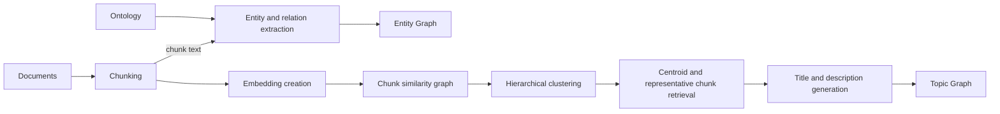

# foundry-iq-graph-lab

English edition of the lab. The Japanese edition is in [../README.md](../README.md).

## Summary

This is a distribution set of five Jupyter notebooks: three functional tests that verify the **Entity Graph, Topic Graph, and ontology** features of Foundry IQ, and two notebooks that use the built graphs from **Agentic Retrieval**. Entity Graph and Topic Graph each go from generation through registration, read-back, visualization, and GQL exploration within their own functional test. For details on Agentic Retrieval, see [Agentic retrieval in Foundry IQ](https://learn.microsoft.com/azure/search/agentic-retrieval-overview).

- **Functional Test 1 (FT1) runs on its own.**
- **The output of Functional Test 2 (FT2) is used by Part B of Functional Test 3 (FT3-B).** Part A (FT3-A) runs without an Azure connection.
- **FT1 chapters 15 and 16 visualize and explore the registered Entity Graph.** They reuse the existing ingestion results and do not ingest again for visualization.
- **FT2 chapter 9 registers the Topic Graph in Foundry IQ, reads it back, then visualizes and explores it.** This is disabled by default. Enable `RUN_FOUNDRY_IQ`, review the registration plan, and approve the first write with `CONFIRM_TOPIC_WRITES`.
- **The two Agentic Retrieval notebooks (AR-E and AR-T below) read and use the existing graphs created by FT1 and FT2.** AR-E ([agentic-retrieval-entity-graph.ipynb](./agentic-retrieval-entity-graph.ipynb)) searches the Entity Graph synced by FT1 in two ways: hand-written GQL and natural-language `retrieve`. AR-T ([agentic-retrieval-topic-graph.ipynb](./agentic-retrieval-topic-graph.ipynb)) uses the topic index registered in FT2 chapter 9 and compares the same question in three modes: `none`, `balanced`, and `diverse`. Neither notebook builds or re-extracts a graph.
- **The set ships ten Markdown articles about fictional World Heritage-style sites in [data/heritage-sites](./data/heritage-sites).** All ten sites are fictional and are not real World Heritage Sites. No notebook reads this folder.
- The input texts (two fictional Hanapedia articles about heritage sites in the fictional English city of Aldermere) are included, but the Foundry IQ Skills runtime is not. **You download and place it from the official source only when you use FT3, or the external JSON-LD validation and conversion in FT1.** You do not need to install Copilot or any plugin.
- Azure resources, Python itself, external dependency packages, and the native Topic Graph executable are not included. An internet connection is required for the initial preparation.
- The saved outputs and execution counts of the notebooks are cleared. No settings file with real endpoints or credentials is included.

Entity Graph deals with relations between entities, and Topic Graph deals with the topic hierarchy of a document set. For the preview conditions and prerequisites of both features, see the Microsoft Learn articles [Entity Graph](https://learn.microsoft.com/azure/search/agentic-knowledge-source-how-to-entity-graph) and [Topic Graph](https://learn.microsoft.com/azure/search/agentic-knowledge-source-how-to-topic-graph).

## 1. Overview and run order



| Notebook | Main input and processing | What it checks | Dependencies |
|---|---|---|---|
| [Functional Test 1: Entity Graph](./functional-test-1-entity-graph.ipynb) | Places the two articles (Thornwick Castle and Elowen Park) in Blob and runs ingestion, vectorization, and relation extraction. Reads back the registered ontology, entities, and relations and draws them | Applying an ontology after the fact, cache reuse, recall, relations that span multiple documents, GQL exploration, aggregation, and evidence text | Does not depend on other notebooks. Uses the built-in ontology; an external JSON-LD is optional |
| [Functional Test 2: Topic Graph](./functional-test-2-topic-graph.ipynb) | Chunks and vectorizes the two articles (Thornwick Castle and Elowen Park) and builds the hierarchy locally. Optionally registers it in a dedicated index, reads it back, and draws it | All stages, membership, output consistency, restoring changed settings, resume, registered counts, hierarchy exploration and aggregation in GQL | Does not depend on other notebooks. Passes the local output to FT3-B |
| [Functional Test 3: Ontology](./functional-test-3-ontology.ipynb) | A: ingests and validates a fixed Turtle ontology. B: a model proposes an ontology from the Topic Graph and the original Foundry IQ index | Ingestion, review, approval, JSON-LD output, rule-violation detection, version differences, evidence for the proposals, and the spending limit | A is independent. B requires FT2 to be complete |
| [Agentic Retrieval: Entity Graph (AR-E)](./agentic-retrieval-entity-graph.ipynb) | Searches the registered Entity Graph of FT1 with hand-written GQL that specifies types and predicates (chapter 3) and with natural-language `retrieve` (chapter 4). Reads back the generated GQL, `activity`, graph rows, and evidence chunks | The difference between direct GQL and search through the knowledge base, the generated GQL and processing time in `activity`, and the referenced graph rows and evidence text | Requires the graph-enabled knowledge source synced by FT1 (default name `ft-entity-ks`). Chapter 4 calls a chat model and newly creates a dedicated knowledge base |
| [Agentic Retrieval: Topic Graph (AR-T)](./agentic-retrieval-topic-graph.ipynb) | Connects the Topic Graph to `ft-topic-src` from FT2 and runs `retrieve` for the same question in three modes: `none`, `balanced`, and `diverse` | A side-by-side comparison of the returned chunks, source references, and `activity` across the three modes | Requires the topic index registered in FT2 chapter 9. Does not use a chat model |

The recommended order is **FT1 → FT2 → FT3-A → FT3-B**. FT1 and FT2 can run independently. Run AR-E after FT1 and AR-T after FT2 chapter 9. If you only want to try the structural validation without Azure, you can start with FT3-A. The first package download is still required.

Functional Test 1 uses the built-in ontology by default. Only when you use the output of FT3, specify the JSON-LD in `ONTOLOGY_PATH`; it is then validated, converted, and registered through the create path. The output of FT3 never updates an existing graph automatically. If an external schema does not contain the types and relations of the built-in tests, T10 to T12 are shown as not run. Configuring Topic Graph search profiles and connecting them to a knowledge base are out of scope. The knowledge base check T13 in FT1 remains optional.

## 2. Distribution contents

| File or folder | Purpose |
|---|---|
| [functional-test-1-entity-graph.ipynb](./functional-test-1-entity-graph.ipynb) | Functional test for Entity Graph |
| [functional-test-2-topic-graph.ipynb](./functional-test-2-topic-graph.ipynb) | Functional test for Topic Graph |
| [functional-test-3-ontology.ipynb](./functional-test-3-ontology.ipynb) | Functional test for the ontology |
| [agentic-retrieval-entity-graph.ipynb](./agentic-retrieval-entity-graph.ipynb) | Agentic Retrieval over the registered Entity Graph (AR-E) |
| [agentic-retrieval-topic-graph.ipynb](./agentic-retrieval-topic-graph.ipynb) | Agentic Retrieval over the registered Topic Graph (AR-T) |
| [Thornwick Castle - Hanapedia.txt](<./Thornwick Castle - Hanapedia.txt>), [Elowen Park - Hanapedia.txt](<./Elowen Park - Hanapedia.txt>) | Input articles for Functional Tests 1 and 2 (fictional Hanapedia articles about two heritage sites in the fictional English city of Aldermere) |
| [data/heritage-sites/](./data/heritage-sites) | Ten Markdown articles about fictional World Heritage-style sites. The list is in the table below |
| [.env.example](./.env.example) | Example settings for endpoints, deployment names, and model prices |
| [.gitignore](../.gitignore) | Settings that exclude runtime configuration, working data, virtual environments, and similar files (the file at the repository root also covers `en\`) |

The ten articles in `data\heritage-sites\` are all fictional. None of these sites is a real World Heritage Site, and no notebook reads this folder.

| File | Title | Type | Setting (fictional) |
|---|---|---|---|
| `01-mistfell-moorland-wetlands.md` | Mistfell Moorland Wetlands | Natural | Scottish Highlands, United Kingdom |
| `02-redcombe-copper-mine.md` | Redcombe Copper Mine and Smelter Works | Cultural (industrial) | South West England, United Kingdom |
| `03-ashpeak-volcanic-island.md` | Ashpeak Volcanic Island | Natural | Off the coast of New Zealand |
| `04-fernbank-terraced-vineyards.md` | Fernbank Terraced Vineyards | Cultural (cultural landscape) | Northern California, United States |
| `05-whitestrand-pottery-village.md` | Whitestrand Pottery Village | Cultural | Coastal Ireland |
| `06-tidemark-point-lighthouses.md` | Tidemark Point Lighthouses | Cultural (maritime) | Pembrokeshire coast, Wales, United Kingdom |
| `07-cedarcrest-forest-railway.md` | Cedarcrest Forest and Logging Railway | Mixed (natural and cultural) | British Columbia, Canada |
| `08-starfall-mesa-observatory.md` | Starfall Mesa Observatory | Cultural (scientific) | High desert, New Mexico, United States |
| `09-silkwater-valley-mills.md` | Silkwater Valley Silk Mills | Cultural (industrial) | New England, United States |
| `10-amberstone-quarry-town.md` | Amberstone Quarry and Sandstone Town | Cultural | New South Wales, Australia |

Keep the input articles and the notebooks in the same folder. For how to download and place the external runtime, see "5.2 Manually downloading and placing the runtime" below.

## 3. Environment and pinned versions

These instructions assume **Windows x64, Python 3.12, and the Jupyter environment in VS Code**. The official runtime below has dependency locks for Python 3.12 / 3.13 / 3.14, but this set has not been run-tested with every combination.

| Item | What this set uses |
|---|---|
| Python | 3.12 recommended. Select the kernel for each notebook |
| SDK for Foundry IQ | `azure-search-documents==12.2.0b1` |
| Foundry IQ API for graph features | `2026-11-01-preview` |
| Topic Graph executable | `topicgraph` 1.0.10. The notebook downloads it after checking a pinned digest |
| Runtime for the ontology | `ontology-skills` 0.1.0 from the official `foundry-iq-skills`, downloaded manually. The commit to download is listed in section 5.2. At startup the runtime verifies the digests of the wheels and locks |
| Authentication | Microsoft Entra ID. Live runs need credentials that `DefaultAzureCredential` can use, such as an Azure CLI sign-in |

The notebook dependencies are installed by the first `%pip install` cell in each of Functional Tests 1 to 3. AR-E and AR-T have no `%pip install` cell. If you get an import error, or if the SDK is not `12.2.0b1`, run the command listed in the "Kernel dependencies" section of each notebook in the kernel you selected. For the ontology CLI, the startup routine of the downloaded runtime prepares a dedicated environment, separate from the notebook kernel, in a per-user cache. Do not replace the downloaded wheels or locks by hand.

Source: [SDK 12.2.0b1](https://pypi.org/project/azure-search-documents/12.2.0b1/) / [Native executable v1.0.10](https://github.com/Azure/foundry-iq-tool-releases/releases/tag/v1.0.10) / [Foundry IQ Skills prerequisites and runtime preparation](https://github.com/microsoft/azure-skills/blob/main/.github/plugins/foundry-iq-skills/README.md)

## 4. Azure prerequisites

**This set uses existing Azure resources.** It does not create a Foundry IQ service, an Azure OpenAI resource, or a storage account, and it does not assign roles. SDK names, API identifiers, environment variables, and built-in role names are shown with their actual names.

| Resource | Required for |
|---|---|
| Foundry IQ with preview support for the graph features | The knowledge source and graph in FT1, and the source index and published topic index in FT2. AR-E reads the knowledge source from FT1. AR-T reads the source index and published topic index from FT2 |
| Azure OpenAI chat deployment | Entity Graph relation extraction, Topic Graph labeling, ontology proposals, and AR-E chapter 4 (retrieval model) |
| Azure OpenAI embedding deployment | Vectorizing the article chunks |
| Standard Blob Storage for the source | Placing the articles for Functional Test 1. Disable the hierarchical namespace. The official Entity Graph procedure does not cover ADLS Gen2 |
| General-purpose v2 storage account (`StorageV2`) for the cache | The Blob container and tables of the enrichment cache in Functional Test 1 |

For the input source of Functional Test 1, enable native Blob soft delete and disable Blob versioning before the first ingestion. T3 verifies the three conditions of the input source and the kind of the cache storage destination. If they do not match, it stops deletion, upload, and knowledge source creation. If you change storage settings or resource IDs, re-run T3. The settings are never changed automatically.

The cited official documentation does not confirm a requirement to disable the hierarchical namespace on the cache storage destination, so the input-source conditions are not applied to the cache. Reachability from Foundry IQ to the storage must be checked separately. Being able to read the ARM settings alone does not verify reachability.

The following are guidelines for permissions. If your existing assignments are sufficient, no additional assignments are needed.

| Identity | Required access |
|---|---|
| Running user | Foundry IQ configuration changes and data operations. As built-in roles: Search Service Contributor and Search Index Data Contributor |
| Running user | Direct calls to Azure OpenAI. As a built-in role: Cognitive Services OpenAI User |
| Running user (new build in Functional Test 1) | Blob write access to the source storage and read access to the ARM settings of both storage accounts |
| Managed identity of Foundry IQ | Storage Blob Data Reader for the source, and Storage Blob Data Contributor and Storage Table Data Contributor for the cache |
| Managed identity of Foundry IQ | Cognitive Services OpenAI User on Azure OpenAI |

Connectivity conditions other than identity, such as firewall settings on the storage and the model, are also required. If you get a 403 or a similar error, do not assume missing permissions and add roles.

Source: [Entity Graph prerequisites](https://learn.microsoft.com/azure/search/agentic-knowledge-source-how-to-entity-graph#prerequisites) / [Blob knowledge source](https://learn.microsoft.com/azure/search/agentic-knowledge-source-how-to-blob) / [Enrichment cache](https://learn.microsoft.com/azure/search/enrichment-cache-how-to-configure) / [Role-based access control for Foundry IQ](https://learn.microsoft.com/azure/search/search-security-rbac)

## 5. Quick start

### 5.1 Folder and kernel

1. Place the repository `foundry-iq-graph-lab` on a writable local disk and open the `en` folder in VS Code.
2. Use **the `en` folder itself** as the workspace folder, not the repository root. The working directory of the notebooks is this folder as well.
3. Select a Python 3.12 kernel. The saved kernel display name is the common `Python 3` in every notebook.

`Path(".")` in each notebook is relative to the working directory. If an article cannot be found, check this location first. Folders under cloud sync and network locations are also discouraged, to avoid locks while Topic Graph saves checkpoints.

The English edition and the Japanese edition each keep their own local work folder (`.functional-test`) under their own directory (`en\.functional-test` for this edition). Both editions create objects with the same names on the service, so do not run them against the same service at the same time. See section 6.

The runtime below is not needed for the built-in ontology of Functional Test 1, for visualizing a registered graph, or for running Functional Test 2.

### 5.2 Manually downloading and placing the runtime

**You need it only for Functional Test 3, and for Functional Test 1 when you specify an external JSON-LD.** The notebooks do not download the runtime automatically. If it is not in place, they explain how to download and place it, and stop.

1. [Download the official Microsoft source ZIP](https://github.com/microsoft/azure-skills/archive/7847020998043c6231929b364c35393b7cdab270.zip). The commit verified for these steps is `7847020998043c6231929b364c35393b7cdab270`. You can browse the [official source](https://github.com/microsoft/azure-skills/tree/7847020998043c6231929b364c35393b7cdab270/.github/plugins/foundry-iq-skills).
2. Extract the ZIP and take out the folder `azure-skills-7847020998043c6231929b364c35393b7cdab270\.github\plugins\foundry-iq-skills`. `bootstrap.py` alone does not work, so take the whole folder, including the manifest, wheels, and locks.
3. Place the extracted `foundry-iq-skills` folder at the same level as the three functional test notebooks, so that it becomes `en\foundry-iq-skills\`. AR-E and AR-T do not use this runtime.

```text
en\
  functional-test-1-entity-graph.ipynb
  functional-test-2-topic-graph.ipynb
  functional-test-3-ontology.ipynb
  agentic-retrieval-entity-graph.ipynb
  agentic-retrieval-topic-graph.ipynb
  foundry-iq-skills\             <-- downloaded and placed by you
    graph\runtime\
      bootstrap.py
      manifest.json
      wheels\
      locks\
```

If you extract it somewhere else, set `FOUNDRY_IQ_PLUGIN_ROOT` in `.env` to **the root that contains the `graph` folder**. It is not the path of `graph\runtime` itself.

```dotenv
FOUNDRY_IQ_PLUGIN_ROOT=D:\tools\foundry-iq-skills
```

After placing it, confirm that both checks below return `True` (run them from the `en` folder). If you use a different location, replace the path accordingly.

```powershell
Test-Path -LiteralPath '.\foundry-iq-skills\graph\runtime\bootstrap.py'
Test-Path -LiteralPath '.\foundry-iq-skills\graph\runtime\manifest.json'
```

Functional Test 3 runs `setup ontology` in the cell of section 1.3. If you only use the external JSON-LD feature of Functional Test 1, run the following once in the existing Python environment you selected, then continue. The first run needs to download dependency packages. This preparation does not call Azure or any model.

```powershell
python -I '.\foundry-iq-skills\graph\runtime\bootstrap.py' setup ontology
```

The downloaded folder is excluded by [.gitignore](../.gitignore), so it is not bundled into this repository again. If you update to a different commit, verify its compatibility with these notebooks.

Source: [Downloading source code archives (GitHub)](https://docs.github.com/en/repositories/working-with-files/using-files/downloading-source-code-archives) / [Official runtime preparation steps](https://github.com/microsoft/azure-skills/blob/7847020998043c6231929b364c35393b7cdab270/.github/plugins/foundry-iq-skills/README.md#prepare-the-graph-runtime)

### 5.3 Settings and sign-in

In PowerShell, move to the `en` folder and copy the example settings.

```powershell
Set-Location 'D:\path\to\foundry-iq-graph-lab\en'
Copy-Item -LiteralPath '.env.example' -Destination '.env'
```

Edit `.env` and replace each `<...>` with the actual value. To use Azure CLI credentials for live runs, sign in to the target tenant.

```powershell
az login --tenant '<tenant-id-or-domain>'
```

| Setting | Where required | Description |
|---|---|---|
| `AZURE_SEARCH_ENDPOINT` | FT1 and FT2 create / publish / read back, AR-E and AR-T | HTTPS endpoint of Foundry IQ |
| `AZURE_OPENAI_ENDPOINT` | FT1 and FT2 create, FT3-B, AR-E chapter 4. AR-T only when a vectorizer is added to the search field | HTTPS endpoint of Azure OpenAI |
| `AZURE_OPENAI_DEPLOYMENT` | FT1 and FT2 create, FT3-B, AR-E chapter 4 | Chat deployment name. Not needed for AR-T |
| `AZURE_OPENAI_EMBEDDING_DEPLOYMENT` | FT1 and FT2 create. AR-T only when a vectorizer is added to the search field | Embedding deployment name |
| `AZURE_STORAGE_RESOURCE_ID` | FT1 create | ARM resource ID of the source storage |
| `AZURE_CACHE_STORAGE_RESOURCE_ID` | FT1 create | ARM resource ID of the cache storage |
| `AZURE_OPENAI_MODEL` | FT1 and FT2 create, when needed. Required for AR-E chapter 4 | Actual chat model name. Specify it when it differs from the deployment name. In AR-E chapter 4, specify it even when it is the same as the deployment name |
| `AZURE_OPENAI_EMBEDDING_MODEL` | FT1 create, AR-T, when needed | Actual embedding model name. The deployment name is used when not set |
| `MODEL_INPUT_PRICE_PER_1M` | FT3-B | Actual price per 1 million input tokens (USD) |
| `MODEL_OUTPUT_PRICE_PER_1M` | FT3-B | Actual price per 1 million output tokens (USD) |
| `FOUNDRY_IQ_PLUGIN_ROOT` | FT3, and the external JSON-LD in FT1, when you change the location | Root of the manually downloaded `foundry-iq-skills`. When not set, the `foundry-iq-skills` folder at the same level as the notebooks is used |
| `TOPICGRAPH_EXE` | Optional | The `topicgraph` executable to verify. When not set, the notebook searches the cache or downloads the pinned version |
| `FOUNDRY_IQ_ENTITY_SOURCE` | AR-E, optional | Name of the Entity Graph knowledge source to search. `ft-entity-ks` when not set |
| `FOUNDRY_IQ_ENTITY_KB` | AR-E, optional | Name of the dedicated knowledge base that chapter 4 creates and reuses. `ft-entity-agentic-kb` when not set |
| `FOUNDRY_IQ_TOPIC_INDEX` | AR-T, optional | Name of the registered topic index. When not set, the record in `.functional-test/published-resources.json` is used, and if there is no record, an index whose name starts with `ft-published-topics-` is searched for. The notebook stops when there are 0 or several candidates |

`FOUNDRY_IQ_ENTITY_SOURCE`, `FOUNDRY_IQ_ENTITY_KB`, and `FOUNDRY_IQ_TOPIC_INDEX` are not listed in [.env.example](./.env.example). Add them to `.env` only when you want to change them. AR-E and AR-T give the values in `.env` priority over environment variables of the same name.

Set the FT3-B prices after checking the pricing of the deployment you use. The distribution does not include past build records, so the prices cannot be filled in from such records. Do not set a price to 0 as a placeholder to get past the budget check.

Source: [Sign in with Azure CLI](https://learn.microsoft.com/cli/azure/authenticate-azure-cli-interactively) / [Azure OpenAI pricing](https://azure.microsoft.com/pricing/details/cognitive-services/openai-service/)

### 5.4 Running the notebooks

1. Run the package installation and settings cells of each notebook.
2. Check the target endpoints, resource names, and the processing that incurs costs. If the validation of an executable or the runtime returns FAIL, do not run the cells after it.
3. In Functional Test 1, set `RUN_BUILD = True` to proceed from generation, and run through chapters 15 and 16. To only read an existing graph, set `RUN_BUILD = False` and `KS_NAME`, then go to chapters 15 and 16 after the setup and T1.
4. Functional Test 2 runs the local build and checks from the top. Setting `RUN_FOUNDRY_IQ = True` in chapter 9 lets you review the registration plan for the dedicated index. Set `CONFIRM_TOPIC_WRITES = True` only when you approve the first write, then run the cells from creation and upload onward. If the topics are already registered, skip creation and read them back.
5. Run Part A of Functional Test 3. If you do not need the part that uses Azure, stop at the result list in chapter 8.
6. To run FT3-B, keep the local output and the source index of FT2, check the prices and the spending limit, and then continue.
7. Run AR-E and AR-T after completing their prerequisite functional tests (FT1 for AR-E, and FT2 up to chapter 9 for AR-T). `RUN_AZURE` switches the connection to Azure. The default is `True` for both AR-E and AR-T. Chapter 3 of AR-E only reads the registered graph. Chapter 4 newly creates a dedicated knowledge base and calls the chat model when you review the plan and set `CONFIRM_WRITES = True`. In AR-T, review the topic connection plan in section 2.2 and set `CONFIRM_WRITES = True` only when changes are required.

When you use an external JSON-LD in Functional Test 1, sections 1.6 and 1.7 validate the original file before any resource change and convert it for submission with the manually downloaded runtime. `urn:...` is not submitted as is; it is converted to `entity:...`, defined in the embedded context, and to the registration namespace. The SHA-256 of the original file and of the submitted content are recorded separately, and T8 checks them against the registered content. The default built-in ontology is also checked against the submitted hash.

To resume with read-only access, use chapters 15 and 16 of FT1 after the settings, drawing helpers, and T1, and sections 9.4 and 9.5 of FT2 after the settings and shared code in 9.1. The registration target of FT2 is restored from `TOPIC_INDEX_NAME` or from the name recorded in `.functional-test/published-resources.json`. In both cases, you can visualize the registered data without a model or the original local artifacts.

In the notebooks, some checks do not stop on the spot even when `check()` returns FAIL. **A cell running to the end is not the same as all checks passing.** Review the details of every FAIL in each result list.

## 6. Generated artifacts, cost, and cleanup

| Target | Main artifacts and side effects |
|---|---|
| Functional Test 1 | `ft-entity-ks` and the indexes it manages, and the `ft-entity` Blob container. Optionally `ft-entity-kb` |
| Functional Test 2 | `ft-topic-src` in Foundry IQ, a temporary scoring profile, and the local `.functional-test/topicgraph-out`. When chapter 9 newly publishes, `ft-published-topics-<hash>` and the saved record of the registration target |
| Functional Test 3 | The state, validation files, and JSON-LD in `.functional-test/ontology`. The storage location of approved data is also isolated inside this work folder |
| AR-E | Chapter 3 is read-only. When you approve in chapter 4, it newly creates the dedicated knowledge base `ft-entity-agentic-kb` (changeable with `FOUNDRY_IQ_ENTITY_KB`). It does not change the existing source or graph |
| AR-T | When you approve, it newly creates the dedicated knowledge source `ft-topic-agentic-ks` and the knowledge base `ft-topic-agentic-kb`, and changes the search settings of `ft-topic-src` (the Topic Graph connection). It does not re-register the topic documents |

**Functional Tests 1 and 2 include processing that deletes and recreates test objects with the same names.** Do not use the same names for existing production resources. Do not run this edition and the Japanese edition, or two copies of the same edition, in parallel against the same endpoint with the same names.

**The English edition and the Japanese edition create objects with the same names on the service** (`ft-entity-ks`, `ft-topic-src`, `ft-published-topics-<hash>`, and so on), and each edition keeps its own local work folder (`.functional-test`) under its own directory. Do not run both editions against the same service at the same time. Re-running the other edition recreates the same-named test objects.

In addition to the running costs of Foundry IQ and storage, usage-based charges apply to embeddings, relation extraction, topic labeling, and ontology proposals. `RUN_KB_TEST` in Functional Test 1 involves additional model calls. `MAX_SPEND_USD` in FT3-B is the budget for that proposal processing, not a spending limit for the whole set. For a new build, the required quota is two indexes for FT1, plus one more index when FT2 publishes. Check the capacity before writing.

`RUN_CLEANUP` in each functional test notebook defaults to `False`. The output and the source index of FT2 are required for FT3-B, so do not delete them first. The published index of FT2 is not deleted automatically by the final cleanup. Check its owner and dependencies and delete it individually. The source Blob and the cache containers and tables of FT1 may also remain. The shared runtime cache is out of scope.

AR-E and AR-T have no `RUN_CLEANUP`. They do not automatically delete the knowledge bases and sources they created, and they do not restore the search settings of `ft-topic-src`. When they are no longer needed, confirm that no app or agent references them, then delete the dedicated knowledge base for AR-E, and the dedicated knowledge base followed by the dedicated knowledge source for AR-T. Do not delete `ft-topic-src`, because FT3-B also uses it. Charges may apply for the retrieval model calls in AR-E chapter 4 and for the question embeddings in AR-T.

## 7. External dependencies and redistribution

Microsoft's [Foundry IQ Skills](https://github.com/microsoft/azure-skills/tree/7847020998043c6231929b364c35393b7cdab270/.github/plugins/foundry-iq-skills) is not included in this repository. Users who need it download and place it following section 5.2. The native Topic Graph executable is also not bundled; Functional Test 2 downloads it from the [pinned release](https://github.com/Azure/foundry-iq-tool-releases/releases/tag/v1.0.10).

When you redistribute a folder after a run, do not include the manually downloaded `foundry-iq-skills`, `.env`, notebook run outputs, `.functional-test`, `.foundry-iq`, virtual environments, or credentials. [.gitignore](../.gitignore) suppresses Git tracking. It does not automatically exclude these items when you create a ZIP by hand.
